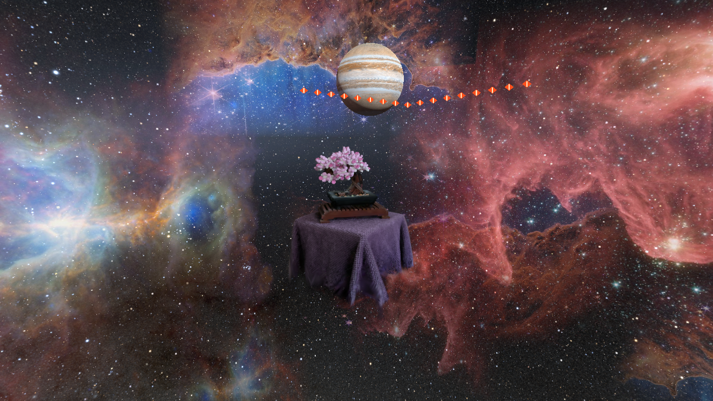
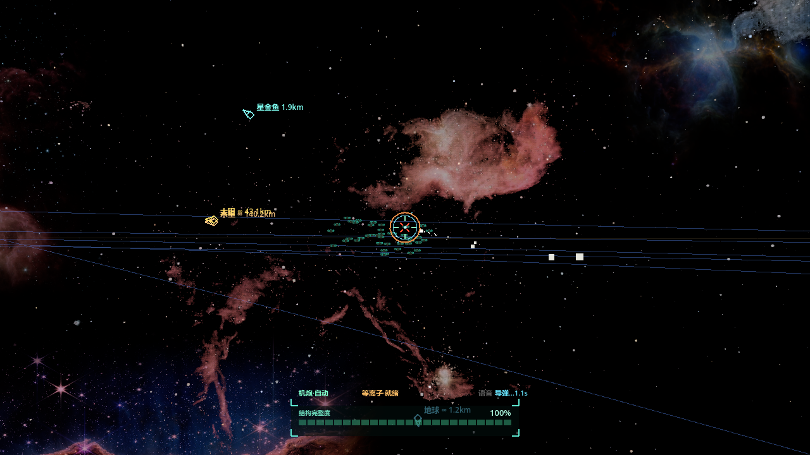
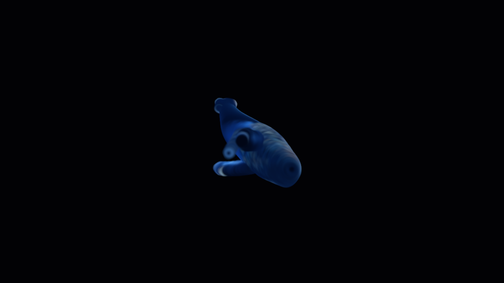
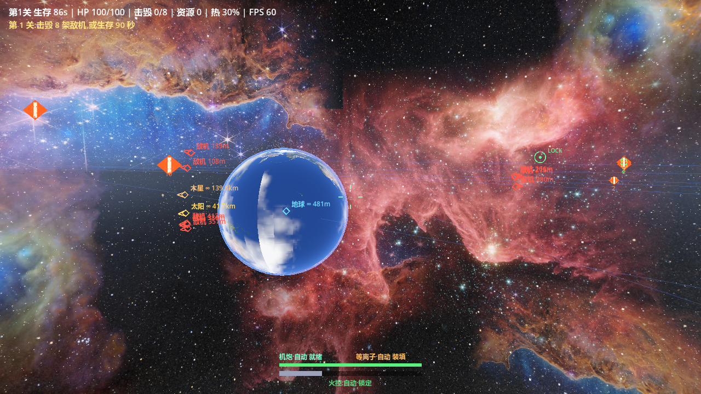
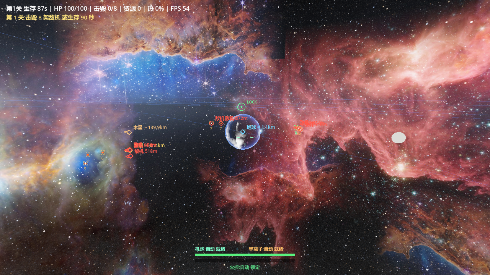
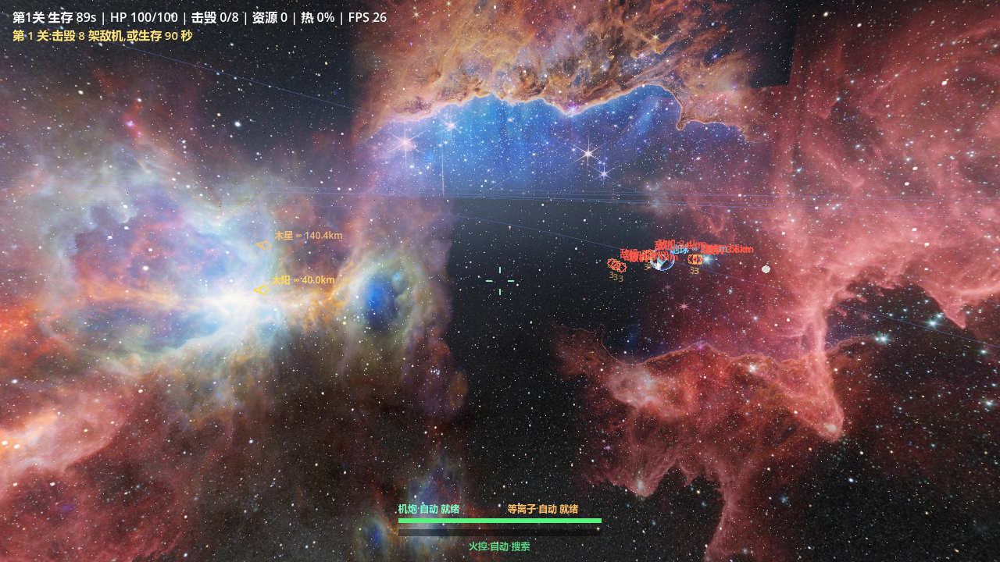
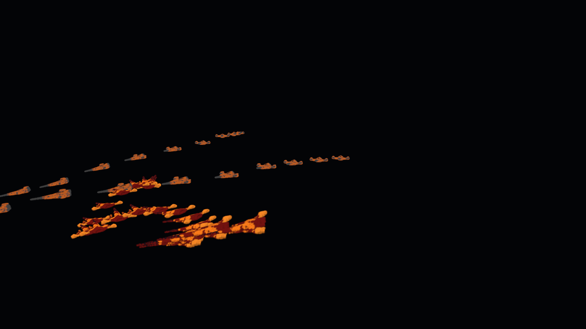

# gdgs-rendering-lab · 太空战斗 Demo

一个用 **Godot 4.7.2 + 3DGS（3D Gaussian Splatting，高斯泼溅）** 做的三关太空战斗 Demo。
行星是高斯泼溅、战机是高斯泼溅、星鲸是动态高斯泼溅；轨道由 J2000 真实要素解算，日食按几何解析求解，战斗数值全部住在一张文本表里，还有一个无人值守的自动验收开关。

> **这个仓库是什么**：代码 + 数据表 + 实测证据 + 精选截图。
> **不是什么**：不含可运行的完整资产。详见 [`.gitignore`](.gitignore) 的排除原因与重建命令。

---

## 目录

- [它长什么样](#它长什么样)
- [技术栈](#技术栈)
- [核心机制](#核心机制)
  - [1. 高斯行星与三级 LOD](#1-高斯行星与三级-lod)
  - [2. 机群流：低模做碰撞，高斯做外观](#2-机群流低模做碰撞高斯做外观)
  - [3. 行星轨道与解析日食](#3-行星轨道与解析日食)
  - [4. 武器与数据表驱动的数值](#4-武器与数据表驱动的数值)
  - [5. 无人值守自动验收](#5-无人值守自动验收)
- [怎么运行](#怎么运行)
- [实测结果与出处](#实测结果与出处)
- [代码地图](#代码地图)
- [已知边界 / 未完成](#已知边界--未完成)
- [第三方与素材署名](#第三方与素材署名)

---

## 它长什么样

3DGS 前景（桌面盆景，27.1 万点）叠在木星与星云之上，红色菱形是公告板敌机：



同一个场景换机位：高斯泼溅与不透明网格的**深度互相遮挡**正确——中间那个蓝色半透明方片是手写的**代理碰撞墙**（`main.gd`），说明 splat 本身不参与物理、必须显式加代理：


实机战斗画面：HUD 左上为关卡/HP/击毁数/FPS，中心是轨道设施标记与星鲸方位，背景是全向星场 + 星云，蓝线是 Kepler 轨道线：



星鲸（动态高斯生物，40.8 万点）掠过：



更多截图在 [`shots/`](shots/)（21 张，含三级 LOD 对照与行星探针图）。

---

## 技术栈

| 项 | 值 | 出处 |
|---|---|---|
| 引擎 | Godot 4.7.2 stable（Forward+） | `autotest-pass-42.3s.log:1`、`project.godot` |
| 3DGS 插件 | `gdgs` v3.3.0（**第三方 MIT**，见下方说明） | `addons/gdgs/plugin.cfg`、`addons/gdgs/LICENSE` |
| 渲染后端 | Raster（默认）；Compute 可选，逐项目设置切换 | `project.godot` `[gdgs] rendering/backend="Raster"` |
| 语言 | GDScript（本仓库 102 个 `.gd`，21,330 行；其中非插件部分 44 个文件 10,476 行） | 静态统计 |
| 主逻辑 | `solar_combat.gd` 单文件 5,210 行 / 224,907 字节 | 静态统计 |
| 工具链 | Python 3.12（烘焙/生成：贴图→高斯、OBJ→高斯、特效高斯、音效） | `tools/`、`_gen_*.py` |
| 分辨率 | 1280×720 | `project.godot` `[display]` |

> **关于插件的来源（重要）**：`addons/gdgs/` 是 **ReconWorldLab** 的 MIT 插件（`plugin.cfg` 的 `author="ReconWorldLab"`，`LICENSE` 的 `Copyright (c) 2026 ReconWorldLab`），最初从上游仓库取得（`docs/evidence/06-本地实验报告-Godot3DGS.md` §1）。**不是本项目自研。**
> 但本仓库里的这份**副本被改过**：`project.godot` 的 `[gdgs] opt/*` 开关（`sh_dc_force`、`ext_precompute`、`inv_precompute`、`frag_exp2`、`srgb_lut`、`min_pixel_size`、`far_sort_fraction`、`compute_sort_budget`、`compute_subpixel_prune`、`compute_reuse_sort`、`compute_lean_clear`）在 `addons/gdgs/runtime/` 下被实际读取（如 `raster_data_textures.gd:47-50`、`raster_render_backend.gd:378-385`、`gaussian_renderer.gd:151-153`），改动与结论记录在 `docs/evidence/15-高斯渲染器优化执行报告.md`、`docs/evidence/16-Compute后端优化AB报告.md`。

---

## 核心机制

### 1. 高斯行星与三级 LOD

行星不是贴图球体，而是**把等距柱状贴图烘成表面高斯点**：太阳被直接烘进 SH band-0（`f_dc` = 颜色、`f_rest` = 0），运行时零着色成本；每个点是切向扁平圆盘（`scale=(s, s, 0.15s)`），两级点数（L0 近密 / L1 远疏）。烘焙器 `tools/bake_planet_splat.py` 的文档字符串与实现（Fibonacci 球面采样 + Shepperd 四元数 + 标准 INRIA binary PLY 输出）就是这条链路的全部依据。

运行时按**角径**切换三级，带迟滞防抖（`solar_combat.gd` 常量区）：

| 角径 | 显示 | 常量 |
|---|---|---|
| ≥ 10.0° | 网格贴图（8k 贴图 + 192 段球） | `SPLAT_LOD_MESH_DEG := 10.0` |
| 3.5° ~ 10° | L0 高斯（近） | `SPLAT_LOD_L1_DEG := 3.5` |
| < 3.5° | L1 高斯（远） | — |
| 迟滞 | 1.5° | `SPLAT_LOD_HYST_DEG := 1.5` |

纯网格行星也有一套三级 LOD：48 / 96 / 192 段（`GRID-LOD` 日志行，如 `autotest-pass-42.3s.log` 中 `GRID-LOD: mercury.jpg r=38.3m 三级就绪(48/96/192 段)`）。L0 高斯是**按需流式加载**的：角径到位才 `ResourceLoader.load_threaded_request()`，离开后宽限 10s 卸载以回收显存（`solar_combat.gd:_tick_l0_stream`，日志里能看到 `SPLAT-L0: earth.jpg 加载完成(400k)`）。

切换用 0.55s 交叉淡化（`_lod_crossfade`），不改渲染队列——注释明确说 v6.12g 弃用的是"整层 alpha 进透明队列"的做法。

三级 LOD 的实测对照图（同一颗地球，角径不同）：

| L0 高斯（12°） | L1 高斯（5°） | 网格（1.5°） |
|---|---|---|
|  |  |  |

### 2. 机群流：低模做碰撞，高斯做外观

敌机不是"每架一份高斯"。`crowd.gd` 把它拆成**机型 × 流**两层：

- **机型** 3 种，各自绑一份低模 OBJ **和** 一份高斯 PLY（`crowd.gd` 的 `TYPES`）：`p1 falcon`（hp×1.0）、`p2 sabre`（hp×0.6，速度快 1.55×）、`p3 bulwark`（hp×2.6，慢但硬）。
- 低模 OBJ 走 `mesh.create_trimesh_shape()` 做**物理判定体 + 远景剪影**（`crowd.gd:66`）；高斯 PLY 只负责**近景外观**。
- 一"流"内所有个体引用**同一个** `GaussianResource`（`_mesh_cache` / `_gs_cache` 静态缓存），内存与显存只存一份。
- 空间复用：超出 `crowd.splat_range = 900` m 的个体由流统一裁决，整体从高斯渲染中剔除、换回低模剪影。

数值全部在 `data/balance.txt`：`[crowd]` 里是 `members = 43`（每流机数）、`gauss_cap = 96`（全局高斯绘制预算，最近 K 架用高斯）、`jet_scale = 0.45`、`splat_range = 900`、`attack_tokens = 10`（每流同时允许开火的上限，其余保持编队整齐飞行）；`[enemy]` 里是 `max_alive = 172`（场上敌机上限 ≈ 两条流）。

同样的机制也用在高斯战机编队的观感上：



**关于"高斯碰撞生成"**：插件确实带一条**高斯→体素→网格**的碰撞生成管线（`addons/gdgs/collision/pipeline/`：`splat_source.gd` 打快照 → `voxelizer.gd` / `gpu_voxelizer.gd` 体素化（走私有 compute shader `collision/shaders/voxelize.glsl`）→ `mesher.gd` 贪心矩形合并暴露面 / `smooth_mesher.gd` → `coplanar_merge.gd`），由 `plugin.gd:_enable_collision_feature()` 以**编辑器 Inspector 插件**的形式注册。
但**本仓库的游戏场景没有用它**：敌机用低模 OBJ 的 trimesh，主场景的高斯盆景用手写的代理盒。仓库里没有任何生成的碰撞网格产物，`solar_combat.gd` 里也没有引用这条管线。（这条界线在[已知边界](#已知边界--未完成)里再强调一次。）

### 3. 行星轨道与解析日食

`solar_ephem.gd` 是一个**解析星历核心**（JPL Standish 近似根数，适用 1800–2050；月球用 Meeus 截断级数；GMST 用 IAU 近似）。它自述是另一个项目两个 ES module 的 GDScript 移植（`solar_ephem.gd` 文件头），并且逐帧打印**直下点对拍**：

```
EPHEM: earth 日心 0.9925,-0.1651,0.0000 au | GMST 248.887° | 太阳直下点经度 -77.22°(星历真值)
EPHEM: 游戏内地球直下点 lat 3.74° lon -77.22° —— 与星历经度差 = EARTH_PHASE 标定值
```
（`autotest-pass-42.3s.log`）

太阳系内容：8 颗行星（位置、轨道平面、椭圆形状全由开普勒解算，半径按真实比例、距离按压缩律）+ 程序化冥王星 + 月球 + 5 颗伽利略/土卫 + 土星环与天王星环 + 小行星带与柯伊伯带（`solar_combat.gd:_build_solar_system`）。

**日食是解析求解的，没有 shadow map**。`solar_combat.gd:_sun_visibility(p)` 把太阳和行星都当圆盘，用两个角的几何关系（本影 / 环食 / 部分重叠，部分重叠用两圆交叠面积占比，含 Heron 因子）算出可见比例；行星作为椭球 proxy 挂在 `occluders` 数组里，每帧用结果给敌机 albedo 调暗。自检打印在每次启动的日志里：

```
ECLIPSE-SELFTEST: behind=0.000 lit=1.000 -> PASS
```
（`autotest-pass-42.3s.log`；判据是 `behind < 0.15 且 lit > 0.95`，见 `_eclipse_selftest`）

尺度上做了明确取舍（`solar_combat.gd` 常量区）：**半径按真实比例**（`RAD_P := 1.0`，地球 Re=1 → 100 m，太阳 = 109.2×地球 = 10,920 m），**距离做幂律压缩**（`DIST_P := 0.6`，1AU → 42,000·AU^0.6 m）。竞技场锚定在地球低轨旁，角径约 16.6°（日志 `ARENA:` 行）。

### 4. 武器与数据表驱动的数值

`data/balance.txt` 是一张 18 个 section 的纯文本表，启动时由 `_load_balance()` 解析进 `BAL`，缺失/缺键时回退到代码里的 `_default_balance()`。改表即改手感，代码不用动；启动时还会打印一份**数值验收报告**（`_balance_report()`）：DPS、过热时间、各关敌机 HP 对应的击杀发数、配额与收入。

表里目前实际生效的玩家武器（按 `data/balance.txt` 与 `solar_combat.gd` 交叉核对）：

| 武器 | 关键数值 | 出处 |
|---|---|---|
| 常驻激光 | 220 DPS，L1 起常驻（`unlock_level = 1`），射程 3800 m，对核心 ×1.15 | `[weapon_laser]` |
| 弹体炮 | 22 伤害 / 0.18s ≈ 5.6 发/s，弹速 520 m/s，存活 3.0s（有效射程 ~1.5km） | `[playergun]` |
| 追踪导弹 | 90 伤害，`enabled = 1`，转向率 2.8 rad/s，发射间隔 1.4s，对核心 ×1.2 | `[missile]` |
| MEGA 光束 | 冷却 60s、持续 2.0s、4000 DPS、半径 14 m、射程 4000 m、对核心 ×2.0 | `[megabeam]`、`_mega_fire` |
| 僚机 ×3 | 每发 18 伤害、间隔 0.5s、射程 300 m、25s 重生、友伤关闭 | `[wingman]` |

**注意**：表里的 `[cannon]`（机炮）与 `[plasma]`（等离子）都是 `enabled = 0`，`[heat]`（过热）也是 `enabled = 0`，且 `_fire_cannon` / `_fire_plasma` 首行就按 `enabled` 早退（`solar_combat.gd:1315-1316`、`1353-1354`）——它们是**历史武器**，代码保留、表项保留，但当前不参与战斗。启动日志里的"数值报告"仍会打印机炮/等离子的理论 DPS，那是**表格值不是实战值**。

### 5. 无人值守自动验收

`solar_combat.tscn -- --autotest` 会让一套自动流程接管：自动转向（`autotest_tick` 里按最近敌机/核心改 `_yaw`/`_pitch`）、HP 低于 40 自动回满（冒烟保护，注释写明"非平衡性测试"）、每 10s 打一行状态、420s 未通关即 `TIMEOUT` 退出码 1。通关三关后打印：

```
AUTOTEST PASS t=42.3 (三关demo全流程: L1歼灭→虫洞结算 → L2保卫+援军剧情 → L3 BOSS+周期支援激光 → 星鲸终局+鲸歌+剧情对话) 总击毁=30
```
（`logs/autotest-pass-42.3s.log`）

它还内置了一堆自检：`ECLIPSE-SELFTEST`、`EPHEM` 直下点对拍、`[SFX] loaded 14/14`、`[EVA] manifest 台词 21 条 (OK)`、`CMDSRV ready: 9 interfaces`。所以一次 autotest 跑完，哈希/星历/日食/音频资源/台词表/外部命令接口都被顺带验过一遍。

---

## 怎么运行

**本仓库不含完整资产**，直接打开会缺资源。要跑起来需要先按下表恢复：

```bash
# 1) 恢复资产（见 .gitignore 末尾的逐条命令），至少需要：
#    assets/textures/planets/*.jpg, assets/textures/8k_jupiter.jpg,
#    assets/textures/nasa_svs/starmap_2020_4k.exr, assets/textures/nebula/*.jpg,
#    assets/textures/nasa_sky_panorama_8k.jpg,
#    assets/demo.compressed.ply, assets/props_mesh/station/station.obj, ...

# 2) 首次导入（生成 .godot 缓存）
Godot_v4.7.2-stable_win64_console.exe --headless --path . --import

# 3) 三关战斗（正常游玩）
Godot_v4.7.2-stable_win64_console.exe --path . res://solar_combat.tscn

# 4) 无人值守验收（420s 超时；退出码 0 = PASS）
Godot_v4.7.2-stable_win64_console.exe --path . res://solar_combat.tscn -- --autotest

# 5) 过程截图 / 开局解锁全部武器 / 压测 / 星历加速
... -- --autotest shots          # 追加过程截图到 shots/
... -- --autotest demo           # L1 起解锁散弹+激光
... -- --autotest stress         # 敌机 ×5 + 120FPS 上限 + 帧率 HUD
... -- --autotest ephem-fast     # 时标 600×，直下点 2.5°/s
... -- --autotest whale_early    # 开局即召唤星鲸

# 6) 其它可独立运行的小场景（都在仓库里）
res://main.tscn        # splat + 代理碰撞 + 深度遮挡 + 射线检测（自动存 3 图后退出）
res://space.tscn       # 星空球 + 木星 + 高斯前景 + 编队（截图模式）
res://space_live.tscn  # 同场景实况自由飞行
res://bench/bench_runner.tscn   # 渲染器评测内核（配 --bench-config=<json>）
```

操作：`鼠标` 视角 · `W/A/S/D` 飞行 · `Q/E` 升降 · `Shift` 加速 · `LMB` 激光 · `RMB` 导弹 · `R` 重开 · `Esc` 退出。

> `_run_*.ps1` / `_*.bat` 是开发时用的本机启动脚本，里面写的是这台机器的绝对路径，**换机器不能直接用**，当作"当时怎么跑"的记录看。

---

## 实测结果与出处

**能在这里查到原始日志的**：

| 结论 | 数值 | 出处 |
|---|---|---|
| 无人值守三关全流程 | `AUTOTEST PASS t=42.3`，总击毁 30 | `logs/autotest-pass-42.3s.log` |
| 同一测试在更早一次的表现 | `AUTOTEST TIMEOUT phase=6 level=3 kills=32/4`（卡在第 3 关最终阶段，420s 未收尾） | `logs/autotest-timeout-v70b.log` |
| 日食解析自检 | `behind=0.000 lit=1.000 -> PASS` | 同上两份日志 |
| 星历直下点对拍 | 游戏内 −77.22° vs 星历真值 −77.22° | `logs/autotest-pass-42.3s.log` |
| 音频/台词/命令接口 | SFX 14/14、台词 21 条、9 个命令接口 | 同上 |
| 星鲸点数 | `WHALE: goldfish 408252 splats` | 同上 |

⚠️ **这次 PASS 是 headless 跑的**。日志里有 `[gdgs] headless environment: rendering backend selection skipped`、`vram=0MB(tex 0MB)`、没有任何 `SAVED`（截图）行——所以它验证的是**游戏流程状态机与逻辑**，**不是渲染，也不是帧率**。（`logs/autotest-timeout-v70b.log` 同样是 headless。）

**只在工作区文档里、本仓库不复算的**（原样收录在 [`docs/evidence/`](docs/evidence/)，不是本仓库的测试）：

| 结论 | 数值 | 出处 |
|---|---|---|
| 27.1 万点样例资产渲染 | 271,123 高斯点，照片级；稳态 58–60 FPS（720p，含公告板与物理，垂直同步封顶） | `docs/evidence/06-本地实验报告-Godot3DGS.md` |
| 高斯↔不透明网格深度互遮挡 | 正确（Raster 后端硬件深度测试） | 同上 |
| splat 是否参与物理 | **不参与**——射线直接穿到后面的代理墙 | 同上 |
| Compute 后端 A/B（whale 40.8 万点） | 帧时间 3.047 ms → 1.247 ms（2.4×） | `docs/evidence/15-…md` §0；`project.godot` 注释 |
| Compute 后端 A/B（fleet 100 实例 22.5 万点） | 反而**慢 36%**，显存约 5×，所以出厂仍用 Raster | 同上 |
| Raster 优化收益 | 显存 fleet 87→57 MB（−34%）、whale 159→91 MB（−43%）；像素 PSNR 100 / maxΔ 0 | `docs/evidence/15-…md` §1 |

⚠️ 关于帧率：`58–60 FPS` 与 autotest 日志里的 `fps=145` **都是垂直同步封顶值**（前者 60Hz 显示器、后者 144Hz；且 autotest 是 headless，该数字无意义）。**两个数都不能当作性能余量的证明。**

---

## 代码地图

```
project.godot            工程配置（主场景 main.tscn；gdgs 后端与 opt/* 开关）
solar_combat.gd  5210行  三关战斗全部逻辑：关卡状态机/武器/火控/敌人AI/道具/BOSS/剧情/HUD/音频/命令接口
solar_combat.tscn        战斗场景入口（-- --autotest 在这里生效）
solar_ephem.gd           解析星历（Standish J2000 + Meeus 月球 + GMST + 直下点）
solar_props.gd           场景道具（中转站 / 雷达相阵 / 八棱柱 BOSS）
crowd.gd                 机群流：机型×流，低模碰撞 + 高斯外观，空间复用
whale.gd                 星鲸（动态高斯，逐球形变，直线匀速巡航）
combat.gd                早期战斗原型
main.gd                  最小验证场景：splat + 代理碰撞 + 深度遮挡 + 射线
space.gd                 星空球 + 木星 + 高斯前景 + 编队（截图 / 实况两用）
lighting_gen.gd          批量为行星 PLY 生成 relight 法线资源（headless）
*_probe.gd / sym_* / mirror_* / hy_live.gd / two_splats.gd / *_showcase.gd
                        调试与验证小场景（自转对齐、镜面对称、UV 标定、LOD 对齐、多高斯组合等）
addons/gdgs/             第三方 MIT 3DGS 插件（导入器 / Raster+Compute 后端 / 光照烘焙 / 碰撞生成）
shaders/                 自研 shader：双层全景天空、星点 billboard、星云、光束、曳光、行星表面与云层、鲸体
tools/                   烘焙与生成工具（贴图→高斯、OBJ→高斯、特效高斯、压缩 PLY、天空全景拼接、音效、放大）
bench/bench_runner.gd    渲染器评测内核（vsync off、确定性场景、逐帧帧时间 + VRAM + A/B 截图）
data/balance.txt         18 个 section 的数值表（武器/热量/敌人/经济/机群/星鲸叙事/BOSS/关卡配额）
data/levels_design.md    关卡与数值设计稿
logs/                    5 份精选证据日志（PASS / TIMEOUT / 日志对照 / 早期流程 / 回归）
docs/DESIGN.md           核心机制详解（3DGS→体素→网格、日食、数值管线）
docs/evidence/           工作区 research/ 里的 3 份实测报告原样收录（帧率与优化数据的出处）
shots/                   精选截图 22 张
```

---

## 已知边界 / 未完成

诚实优先。下面每一条都是本仓库内可核实的。

### 1. 仓库不含可运行资产，`--autotest` 无法在此仓库复现

`.godot/`（6,373.7 MB）、第三方模型源件（`assets/models_src/` 614.5 MB、`assets/props_mesh/` 489.9 MB、`assets/goldfish_src/` 378.6 MB）、烘焙产物（`assets/splat_planets/`、`assets/props/`、`assets/whale/`、`assets/goldfish/`）、音频（`assets/music/` 63.6 MB、`assets/sfx/`）、以及所有 >50MB 的单文件都被排除了。重建命令在 [`.gitignore`](.gitignore) 末尾。

### 2. 那份 42.3s 的 PASS 早于当前代码和当前数值表

- `logs/autotest-pass-42.3s.log` 时间戳 **2026-09-14 01:05:29**
- `data/balance.txt` 时间戳 **2026-09-14 11:16:34**（晚 ~10 小时）
- `solar_combat.gd` 时间戳 **2026-09-14 12:20:15**（晚 ~11 小时）
- `main.gd` **2026-09-16 04:29**、`project.godot` **2026-09-16 05:15**、`addons/gdgs/runtime/render/compute/` 下的文件 **2026-09-16 04:40–05:09**（再晚约 2 天）

也就是说：Compute 后端那段"修了 7 个 bug"的工作（`project.godot` 的 M5-D 注释、`docs/evidence/15` §8.4）是在那次 PASS **之后**做的。

更关键的是**关卡配额变了**。PASS 那次日志里三关的配额是 `kills=0/8` → `2/10` → `4/4`；而 PASS 时点旁的另一份备份 `data/balance.txt.bak_v71` 正是 `l1_quota = 8 / l2_quota = 10 / l3_quota = 4`。当前 `data/balance.txt` 是 `160 / 180 / 80`（20×/18×/20×）。另外 `economy.survival_time` 也从 90 提到了 300。

**所以：42.3s 是那次快照的结果，不能声称是当前这棵树的结果。当前树我无法运行（见上一条），因此未复现、不背书。**

### 3. "火控锥 + 迭代提前量"在当前代码里不存在

`solar_combat.gd` 的文件头注释（第 2、4 行）仍写着"火控(锥+提前量)"、"锥内自瞄自射"，但：

- `_update_fire_control()`（第 1957 行）从 **v6.16 起就是一个空壳**——函数体第一句注释是「v6.16:自动锁敌全部移除 —— 不选目标、无锥判定、无自瞄、无锁定音」，然后把所有 `lock_*` 置空返回。
- `_intercept()`（第 1968 行，迭代求拦截点）**在整个工程里没有任何调用点**（我 grep 了全部 `.gd`，只有定义那一行）。是死代码。
- `data/balance.txt` 的 `[firecontrol] auto_cone = 30.0` **没有任何代码读取**（grep `_b("firecontrol"` / `auto_cone` 只有 `_default_balance()` 里的字面量）。

当前**唯一**真正生效的角度容差逻辑是激光的 `weapon_laser.hit_cone = 1.8°`（`_tick_laser` 第 1575 行起：束方向永远等于准星方向，只是按角度容差把最近的一架判为命中）。**是 1.8°，不是 5°；也不是"解算拦截点"。**

### 4. 数值表项数不是 43

PASS 那次日志打印的是 `balance: 载入 102 项`；按 `_load_balance()` 的解析口径静态统计当前 `data/balance.txt` 是 **115** 条。都不是 43。（顺带一提，表里恰有一项 `[crowd] members = 43`。）中间演进可见于 `logs/autotest-v16-earlier-flow.log`（54 项）与 `logs/final-regression.log`（93 项）。

### 5. `addons/gdgs` 是第三方插件，不是自研

见[技术栈](#技术栈)下的说明。可以主张的是"**在上游 MIT 插件上做了渲染器优化与 bug 修复**"（`docs/evidence/15`、`16`），不能主张"自研了 3DGS Godot 插件"。

### 6. "高斯→体素→网格→可碰撞"这条链路的边界

管线代码是真的（`addons/gdgs/collision/pipeline/`，含 GPU 体素化 compute shader 与贪心面合并网格器），但：

- 它只在**编辑器**侧注册（`plugin.gd:_enable_collision_feature()` 注册的是 `EditorInspectorPlugin`），依赖 `self_test()` 与一个编辑器面板触发；
- 这条管线**没有任何单元测试或实测日志**留在仓库里，我也没有运行过它；
- **游戏本身没用它**：敌机碰撞来自低模 OBJ 的 trimesh（`crowd.gd:66`），高斯盆景场景用手写代理盒（`main.gd` 的 `wall_body`）。仓库里找不到任何生成的碰撞网格产物。

所以准确的表述是"**插件具备**这项能力"，而不是"**这个 Demo 用它实现了**高斯场景可碰撞"。

### 7. 3DGS 的性能结论都是单机单次

全部性能数字来自一台 RTX 5060 8GB / Windows 11 / Godot 4.7.2 的机器（`docs/evidence/06` 表头、`15` 表头）。没有跨 GPU、跨驱动、多次重复的统计；`15` 自己注明"交错 A/B，各配置 3–6 次取 min"（**取 min**，不是均值分布）。且如上所述，`58–60 FPS` 是 vsync 封顶值。

### 8. 测试覆盖很薄

- 唯一的端到端测试是 `--autotest`，它是**冒烟测试**：`autotest_tick` 里低于 40 HP 会自动回满（注释："冒烟保护:确保流程走完(非平衡性测试)"），所以它**不能**用来验证平衡性或"玩家能打赢"。
- 它还是 **headless** 的，不覆盖任何渲染路径。
- 没有任何单元测试框架、没有 CI；（`addons/gdgs/` 内部的 `self_test()` 只做"模块能否编译并返回合法字典"级别的检查）。
- `bench/bench_runner.gd` 的文件头写着"由 Python 编排器调用"，但**那个 Python 编排器不在本仓库里**，所以 `bench/` 目前不可独立运行。

### 9. 资产与内容角度的边界

- 大部分贴图来自 NASA（公版）与 Solar System Scope（CC BY 4.0），逐项署名在 [`assets/textures/ASSETS_LICENSE.md`](assets/textures/ASSETS_LICENSE.md)；地形/深度贴图做过程序化调色（同文件注明）。
- 主力样例资产 `demo.compressed.ply`（27.1 万点）来自 ReconWorldLab 仓库 Releases，MIT。
- 台词音频是 TTS 产出，BGM 是 NotaGen 生成——**都不是真人录音/作曲**。
- 关卡里的"星鲸"实际模型是**金鱼**（`whale.gd` 的 `GOLDFISH_PLY`、日志 `WHALE: goldfish 408252 splats`）。"星鲸"是叙事命名，不是座头鲸模型。（`assets/whale/whale_humpback.ply` 是另一份程序化烘焙产物，当前 `whale.gd` 并未使用它。）
- 关卡只有 3 关，是 Demo 而非完整游戏；`balance.txt` 与设计稿（`data/levels_design.md`，表格排到 L15）给 L1–L15 留了曲线，`_apply_level()` 里也有 `level > 15` 的无尽段分支，但那部分**没有实现为可玩内容**，只有数值与设计。

### 10. 零散的不一致

- `solar_combat.gd` 里三处注释写"太阳 r=6960m"，但常量是 `SUN_R := 10920.0`（注释是早期 `SOLAR_SCALE=1e-5` 时期的残留；实际用的是 109.2×地球，与真实比例一致）。
- 游戏里有一个"EVA 语音指令"通道（按住 `V` 说话、松开转写，`voice_intent.py` 是外部依赖）和 9 个外部命令接口（`user://commands/inbox.jsonl`），这些依赖项都在仓库外。
- `_run_*.ps1` / `_*.bat` 里是本机绝对路径。
- 已删掉的 `.godot` 缓存意味着第一次打开工程会比较慢（要重新导入 PLY/EXR）。

---

## 第三方与素材署名

| 组件 / 素材 | 来源 | 许可 |
|---|---|---|
| `addons/gdgs/`（3DGS 插件本体，本地有改动） | ReconWorldLab · gdgs 3.3.0 | MIT（见 `addons/gdgs/LICENSE`） |
| `assets/demo.compressed.ply`（27.1 万点样例，**未入库**） | ReconWorldLab Releases `sample-assets` | MIT |
| `assets/textures/nasa_sky_panorama_8k.jpg`、`nasa_svs/starmap_2020_4k.exr`、`nebula/PIA03096.jpg`、`nebula/PIA25434.jpg`、`nebula/carina_nebula.jpg`、`planets/earth.jpg`（**均未入库**） | NASA / NASA SVS（公版） | Public Domain |
| `assets/textures/8k_jupiter.jpg`、`8k_stars_milky_way.jpg`（**均未入库**） | Solar System Scope | CC BY 4.0 |
| 全景天空拼接 | `tools/make_sky_panorama.py` 由上述 NASA 公版图程序化生成 | — |
| 台词音频 / BGM | TTS / NotaGen 生成 | — |

逐项 URL 见 [`assets/textures/ASSETS_LICENSE.md`](assets/textures/ASSETS_LICENSE.md)。

---

## 关于 AI 辅助

本仓库的代码与文档均在**大量 AI 辅助**下完成（Claude Code / DeepSeek Harness 等 agent 工具，
协作方式是「人定方向与验收标准，AI 执行与自查，人逐项核对」）。README 本身也是 AI 起草、人工核对后的产物。

写这一节不是为了免责，而是因为**这就是它真实的工作方式**，而且它解释了这个仓库的一些特征：

- 每个数字都要求有出处（代码、日志或 `docs/evidence/`），**查不到就标「未核实」**
- 多处被推翻的早期说法**保留在「已知边界」里**，没有悄悄删掉
- 交付前做过机器核查，修掉过几处写错的声明

> 判断与把关是人做的，AI 承担执行与自查。
